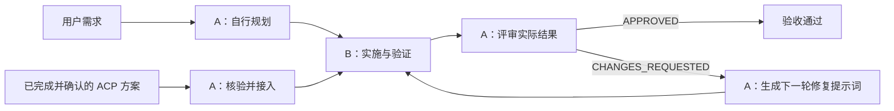

# PIR：规划 → 实施 → 评审

PIR（Plan → Implement → Review）是一套以本地任务包为核心的代理协作技能，用于串行完成规划、实施、评审和多轮修复。

它通过自包含的提示词、基于证据的实施报告、评审结论和持久化状态，让任务能够在不同代理或不同会话之间接续。规划可以由 PIR 自行完成，也可以接入已完成并获确认的 ACP 最终方案。

当前版本由流程规范、交接模板和入口配置组成。实际文件修改、命令执行和验证依赖运行技能的代理及其工具；技能目录没有提供自动调度或状态校验脚本。

## 适用场景

- 由代理 A 规划和评审，代理 B 负责实施，需要明确职责和交接内容。
- 任务无法在单次会话中完成，需要保存方案、验收标准、报告和下一步行动。
- 希望评审实际文件与验证证据，而不只依赖实施者的完成声明。
- 评审后需要多轮修复，并保留每一轮的提示词、结果和问题。
- 已有正式完成的 ACP 方案，需要核验当前工作区并转入实施。
- 代码之外的文件或其他产物任务，需要记录源文件基线和可观察的验收标准。

## 工作方式

| 角色 | 职责 |
|---|---|
| 代理 A：规划者／评审者 | 理解需求，检查工作区，制定方案和验收标准；实施后检查结果，必要时生成修复提示词 |
| 代理 B：实施者 | 按实施或修复提示词修改文件，执行验证，保存实施报告 |



任何阶段遇到关键输入、权限、环境或证据问题，都可以进入 `BLOCKED`，记录阻塞原因和准确的恢复位置。

工作流有三个核心原则：

1. **交接必须自包含。** 接收代理不能依赖发送代理的隐藏对话记忆。
2. **共享工作区串行修改。** 同一时间只有一个代理修改共享文件。
3. **完成必须经过评审。** 实施者报告完成，不等于任务验收通过。

A／B 表示职责分工。当前技能没有提供自动创建代理、消息发送、角色隔离或自动调度循环的实现，使用者或宿主代理需要实际安排角色和交接。

## 快速开始

使用前，确保当前代理能够加载本目录的 [SKILL.md](SKILL.md) 和配套参考文件，并将会话工作目录设为目标项目目录。

推荐明确写出 `$pir`、任务目标和本轮阶段。下面的批次路径均为示例，接续时应替换为实际生成的批次路径。

### 1. 让代理 A 规划新任务

```text
$pir 为订单取消功能创建新任务并自行规划。

目标：用户可以取消尚未发货的订单。
约束：只修改订单模块，不变更数据库结构。
验收：已发货订单不可取消，重复取消不产生重复副作用。

本轮只生成 plan.md、implementation-prompt.md 和 state.yaml，
不修改源码。若缺少关键业务契约，列为阻塞问题。
```

如果目标、组件和验证要求已经能够从当前项目确认，不必额外指定任务 ID 或输出目录。PIR 会在当前任务根目录下创建一个不冲突的批次。

### 2. 将完整任务包交给代理 B 实施

让代理 B 能够访问目标源文件及同一批次的完整任务包，然后发送：

```text
$pir 执行批次 pir/2026-10-30-001-order-cancel/。

读取 state.yaml，核验任务身份和工作区基线，
按当前轮的实施或修复提示词完成修改与验证，
保存实施报告并更新状态。
```

代理 B 应先确认提示词为 `READY`，再修改文件。任务材料或基线不匹配时返回 `BLOCKED`，不能自行重置工作区。

### 3. 回到代理 A 评审

```text
$pir 评审批次 pir/2026-10-30-001-order-cancel/。

对照原始目标、方案和验收标准检查实际差异及验证证据。
保存评审报告；如需修改，生成下一轮自包含修复提示词。
```

只有 `APPROVED` 表示本轮验收通过。结论为 `CHANGES_REQUESTED` 时，代理 A 还要保存下一轮修复提示词。

### 4. 执行修复轮次

```text
$pir 执行批次 pir/2026-10-30-001-order-cancel/ 的当前修复轮次。
使用 state.yaml 指向的 repair_prompt，保留此前实施修改。
```

修复实施完成后，再由代理 A 评审。持续复用同一任务批次，直到评审返回 `APPROVED` 或 `BLOCKED`；`BLOCKED` 表示暂时停止推进，不表示任务成功完成。

### 5. 接续已有任务

```text
$pir 继续批次 pir/2026-10-30-001-order-cancel/，
先核验 state.yaml，再按 next_action 推进。
```

明确的阶段请求优先。未指定阶段的新任务从规划开始；“继续”则依赖已有批次及核验后的状态。

## 阶段选择与规划来源

| 用户提供的内容或请求 | 选择的阶段 |
|---|---|
| 新需求，或要求制定方案 | 规划 |
| 明确要求把 ACP 最终方案转为实施批次 | ACP 接入 |
| 实施提示词、修复提示词，或“执行当前批次” | 实施 |
| 实施报告，或“评审当前批次”“检查是否完成” | 评审 |
| “继续” | 核验既有批次，读取状态及 `next_action` |

PIR 支持两种规划来源：

| 来源 | 条件 | 处理方式 |
|---|---|---|
| `PIR` | 用户没有指定 ACP 方案 | 检查工作区，根据用户请求自行制定方案 |
| `ACP` | 用户明确指定 ACP 方案并要求接入 | 核验 ACP 来源和当前工作区，再生成 PIR 规划产物 |

没有提供 ACP 时，不自动扫描 ACP 批次。明确指定的 ACP 输入存在问题时，不得悄悄切换为自行规划。

任务身份、阶段或来源存在实质歧义时，先澄清再写入。仅省略工作区路径本身，不构成阻塞，前提是当前目录默认值已经足以确定任务。

## 各阶段的详细能力

### 规划

规划前检查：

- 适用的项目指令、技能指令和仓库指南。
- 相关源码、组件或其他源文件。
- 当前仓库版本，以及已有未提交修改及其归属。
- 允许修改的范围和排除项。
- 可用的构建、测试或其他验证方式。

方案必须区分已核验事实、假设和待解决问题，不能把推测表述为仓库事实。

方案至少包含：

1. 目标及用户可见结果。
2. 当前状态和涉及的文件或组件。
3. 约束、排除项、依赖和风险。
4. 可观察、可检查的验收标准。
5. 有顺序的实施步骤，以及对应的验证方式。
6. 实施前必须解决的阻塞问题。

规划阶段生成 `plan.md`、`implementation-prompt.md` 和 `state.yaml`。不会提前创建实施报告或评审报告；相应产物路径在生成前保持为 `null`。

实施提示词需要包含任务 ID、相对批次路径、规划来源、目标、已核验背景、工作区映射、基线、范围、约束、验收标准、验证要求和完整的结果报告要求。ACP 来源还需要带入来源摘要、状态及相关核验限制。

提示词第一行的规范要求为以下二者之一：

```text
Prompt status: READY
```

```text
Prompt status: NOT_READY
```

关键输入缺失时，保存已核验上下文和 `NOT_READY` 提示词，将批次置为 `PLANNING / BLOCKED`，不允许把未经核验的猜测变为可执行指令。现有模板与首行要求之间的差异见本文“当前限制与已知问题”。

### ACP 接入

调用示例：

```text
$pir 基于 ACP 方案
acp/2026-10-30-001-order-cancel/merges/merged-final.md
创建 PIR 批次。

核验 ACP 完成状态、负责人接受情况和当前工作区，
生成 plan.md、implementation-prompt.md 和 state.yaml。
本轮不要修改源码。
```

能够生成 `READY` 实施提示词的 ACP 来源必须满足：

- 来源为规范的 `acp/<batch>/merges/merged-final.md`。
- 对应 ACP 状态文件中，`phase: COMPLETE` 且 `status: COMPLETE`。
- ACP 决策负责人已接受合并结果。
- 任务身份、目标、范围、约束和验收标准匹配。
- 当前工作区与方案描述的基线不存在冲突。
- 方案足够详细，能够确定目标组件、验证方式、风险、监控和回滚。

仅粘贴完整方案或提供未跟踪的方案，当前规则仍不允许直接生成 `READY` 提示词。`AGENT_FINALS_READY`、`MERGING`、`NEEDS_EVIDENCE`、`BLOCKED` 等 ACP 状态也不满足就绪条件。

接入过程要求：

1. 在当前任务根目录下解析来源路径，拒绝路径穿越或根目录之外的来源。
2. 验证前将可读取的原始方案原样复制为 `input/acp-plan.md`，无效输入也保留为阻塞证据。
3. 阅读 ACP 状态、合并方案和相关决策证据。
4. 核验完成状态、任务身份及决策负责人接受情况。
5. 计算复制方案的 SHA-256，记录来源路径、任务 ID、状态和核验限制。
6. 独立检查当前工作区，确认方案中的路径、组件和基线仍然成立。
7. 将 ACP 决策映射到当前工作区和 PIR 验收标准，生成规划产物。

如果 ACP 未记录版本信息，应记录核验限制；如果方案与当前基线冲突，必须阻塞，不能重置工作区。后续实施和修复还需要核验快照摘要及来源状态／身份；发现变化时停止，不能悄悄吸收变化。

ACP 是 PIR 的规划输入。PIR 使用自己的任务批次和状态，后续实施、评审和修复产物都保存在 PIR 批次中。

### 实施

第一轮使用 `artifacts.implementation_prompt`，后续修复轮使用 `artifacts.repair_prompt`，同时保留原始方案。

编辑前检查：

- 提示词第一行是否为 `Prompt status: READY`。
- 任务身份和批次是否匹配。
- 当前版本及已有修改是否符合预期。
- 本地项目规则、技能指令和相关源文件。
- ACP 快照的摘要、来源状态及任务身份，若适用。

基线不匹配时返回 `BLOCKED`，不能自行重置工作区或猜测。修复轮次中，前序轮次已经产生的预期修改不属于基线不匹配。

实施时只负责允许范围内的修改，保留用户已有工作，不因发现相邻改进而扩大范围。修改后检查实际差异和最终文件列表，运行验收标准要求的最小且有意义的检查。

| 验证结果 | 含义 |
|---|---|
| `PASS` | 检查通过 |
| `FAIL` | 检查执行后失败 |
| `SKIPPED` | 未执行 |
| `ENV_BLOCKED` | 因环境条件无法执行 |

实施报告记录修改文件及归属、当前版本、验证命令及证据、未运行的检查、相对提示词的偏离、未解决问题和风险，并更新 `state.yaml`。

实施报告本身的状态为 `COMPLETED`、`PARTIAL` 或 `BLOCKED`。`COMPLETED` 不等于最终验收通过，仍需评审。需要持久保存的验证证据保存在本批次内。

### 评审

首次评审至少需要三个已有的 Markdown 输入：`plan.md`、`implementation-prompt.md` 和 `implementation-report.md`，并能够检查实际文件或差异及验证证据。

`review-report.md` 是评审输出，不需要提前存在。修复轮次还要读取当前修复提示词和此前评审记录；ACP 来源需要检查相应快照和来源元数据。

评审优先检查实际文件、`git diff`、基线、当前版本和验证输出，确认没有混入归属不明或并发产生的修改。不能仅凭实施者摘要批准任务。

| 主要结论 | 含义 |
|---|---|
| `APPROVED` | 验收标准满足，证据充分 |
| `CHANGES_REQUESTED` | 存在必须修复的具体问题 |
| `BLOCKED` | 缺少必要材料、权限、环境或证据，无法完成评审 |

每次评审只给一个主要结论。验收项使用 `PASS`、`FAIL` 或 `UNVERIFIED` 标记。

问题严重性定义：

- `P0`：阻碍安全使用或违背核心目标。
- `P1`：实质性未满足验收标准，或造成重大缺陷。
- `P2`：较小的正确性、可维护性或文档问题。

每个问题都必须说明可获取的位置、违背目标或验收标准的原因，以及具体修复方法。

环境检查受阻不会自动使整次评审变为 `BLOCKED`。评审者先把受影响的验收项标为 `UNVERIFIED`，再判断缺失证据是否阻碍批准，并据此选择结论。无法检查相关实施结果或必要证据时，不能标记为 `APPROVED`。

### 多轮修复

结论为 `CHANGES_REQUESTED` 时，评审者保存本轮评审报告，并生成下一轮自包含修复提示词。

修复提示词必须重述完整目标、规划来源、背景、任务 ID、相对批次路径、原始基线、预期当前版本及修改、范围、约束、未通过的验收标准、修复要求、验证方式和报告要求。不能只写“修复评审发现的问题”。

每轮修复都生成新的修复提示词、实施报告和评审报告。原始方案与首次实施提示词保持不变，原始基线作为历史证据保留，不作为重置目标。

## 任务包与状态

所有任务文档和需要持久保存的验证证据位于当前任务根目录下的同一批次：

```text
<task-root>/pir/YYYY-MM-DD-NNN-task-slug/
├── state.yaml
├── plan.md
├── implementation-prompt.md
├── implementation-report.md        # 由实施者创建
├── review-report.md                # 由评审者创建
├── input/
│   └── acp-plan.md                 # 仅 ACP 接入时存在；不可变快照
├── evidence/                       # 持久验证证据，可选
└── iterations/
    ├── 002/
    │   ├── repair-prompt.md
    │   ├── implementation-report.md
    │   └── review-report.md
    └── 003/
        └── ...
```

新批次名称使用用户本地日期、该日期下一个未使用的序号和简短描述；不能覆盖现有批次。

| 状态字段组 | 内容 |
|---|---|
| 身份 | `task_id`、`bundle`、`objective` |
| 进度 | `phase`、`status`、`iteration`、`next_action` |
| 来源 | `planning_source`，适用时的 `acp_source` |
| 工作区 | 根目录、原始基线、当前版本、已有未提交文件 |
| 边界 | 允许路径、排除路径、约束 |
| 验收 | 验收标准及验证方式 |
| 产物 | 方案、当前提示词、报告和历史记录的路径 |
| 阻塞 | 待解决问题和阻塞原因 |

`phase` 表示工作流位置，允许值为：

```text
NEW
PLANNING
READY_FOR_IMPLEMENTATION
IMPLEMENTING
READY_FOR_REVIEW
REVIEWING
ITERATING
```

`status` 表示当前结果，允许值为：

```text
PLANNED
IMPLEMENTING
REVIEWING
CHANGES_REQUESTED
APPROVED
BLOCKED
```

规划就绪时使用 `READY_FOR_IMPLEMENTATION / PLANNED` 和 `Prompt status: READY`。规划缺少关键输入时使用 `PLANNING / BLOCKED` 和 `Prompt status: NOT_READY`。

`artifacts` 仅指向已经生成的文件，待生成报告的路径为 `null`。进入下一修复轮时，保留原始方案和实施提示词路径，将新一轮实施／评审报告路径重置为 `null`，并在 `history` 中保留此前轮次的产物路径。

完整字段和报告模板见 [交接包结构](references/handoff-schema.md)。

## 批次选择与任务恢复

按以下优先级选择批次：

1. 用户明确指定的任务 ID 或相对于任务根目录的任务包路径，先核验其属于当前任务。
2. 当前对话已经关联并核验的批次。
3. 与任务及阶段唯一匹配的未完成批次。

存在多个匹配时先澄清，不能仅按最新日期选择。ACP 来源的批次还要匹配来源相对路径和已记录摘要，不能复用为另一个来源的任务。

同一任务始终使用相同的 `task_id` 和批次：

- 第一轮产物位于批次根目录。
- 后续轮次位于 `iterations/002/`、`iterations/003/` 等目录。
- 每次评审要求修改并分配下一轮时，迭代编号增加一次。
- 换代理、换日期或切换阶段，不增加迭代编号，也不创建新批次。
- 实施、评审和修复需要可识别的现有批次，不能因材料缺失创建替代任务。
- 此前阻塞的 ACP 输入解决问题后，复用同一 PIR 批次和实施迭代，并保留阻塞历史。

## 工作目录与跨代理交接

任务根目录是运行代理的当前会话目录。默认目标范围为该目录及其子目录，同时受实际权限、项目规则和用户约束限制。所在 Git 仓库不会自动扩大任务根目录。

技能安装目录与任务产物目录是分开的。应在具体项目目录启动任务，使 PIR 文档保存在该项目下的 `pir/` 中。

路径规则：

- 工作区、允许路径和排除路径以任务根目录为基准。
- `artifacts` 和 `history` 中的产物路径以批次目录为基准。
- 一个阶段内保持任务根目录不变，即使工具在子目录运行。
- 不能把 PIR 文档移到任务根目录之外来绕过写入限制。

跨代理或跨机器时：

1. 接收方用自己的当前任务目录解析相同的相对批次路径。
2. 不直接使用发送方的绝对工作区路径。
3. 写入前重新核验任务 ID、相关源文件及预期版本／修改。
4. 接收方需要能够读取相关源文件和完整任务包；技能没有自动传输、打包或同步工作区的实现。

只交接一份实施报告，不足以完成正式评审。应交接完整任务包或接收方可读取的相对路径。

对于非 Git 任务，版本可以为 `null`，但必须描述等效的源文件基线。任务生成的 PIR 文档与已有源文件修改分别跟踪。

## 技能文件

| 文件 | 作用 |
|---|---|
| [SKILL.md](SKILL.md) | 阶段、流程、准入条件、状态和质量要求 |
| [references/handoff-schema.md](references/handoff-schema.md) | 任务包结构、状态字段、方案及交接报告模板 |
| [agents/openai.yaml](agents/openai.yaml) | 界面名称、简介和默认调用提示词 |
| [README.md](README.md) | 面向使用者的能力说明和操作示例 |

正式执行以技能规范和适用的项目规则为依据。README 说明当前规范定义的行为，不代表已完成全部环境和任务类型的端到端验证。

## 当前限制与已知问题

### 能力边界

| 当前情况 | 影响 |
|---|---|
| 没有自动调度或校验脚本 | 阶段转换、串行修改、报告完整性等依赖代理遵守文档执行 |
| 定义 A／B 角色，没有代理启动、隔离和交接机制 | 需要使用者或宿主代理安排，不能据此认为已经实现独立代理自动闭环 |
| 没有任务包自动传输机制 | 跨机器使用仍需准备工作区和任务文件 |
| 没有机器可执行的状态 Schema 校验 | 字段遗漏、非法状态组合和错误路径可能无法及时发现 |

### 已知规范差异

1. **实施提示词首行要求与模板不一致。** [主规范](SKILL.md)要求文件第一行必须是 `Prompt status: READY` 或 `Prompt status: NOT_READY`；[交接模板](references/handoff-schema.md)先写 `# 实施提示词`，之后才写状态。直接复制模板保存，按严格实施规则会被拒绝。生成实施提示词时应遵守主规范的首行要求；模板本身仍待统一。
2. **结束状态对应的阶段没有完整规定。** `APPROVED`、`BLOCKED` 属于 `status`，允许的 `phase` 中没有完成阶段，也没有明确批准后统一保留哪个阶段。当前成功结束条件以 `status: APPROVED` 判断，最终阶段的统一映射仍待完善。
3. **修复模板的 ACP 相对路径参照容易混淆。** 通用约定以批次目录解析产物路径，修复模板则使用 `../../input/acp-plan.md`，采用修复文件所在目录作为参照。路径可以成立，但“相对批次目录”和“相对当前文档”需要明确区分；当前规范尚待统一表述。

以上问题是现有规范中的已知限制，README 的编写没有修改技能行为或配套模板。
